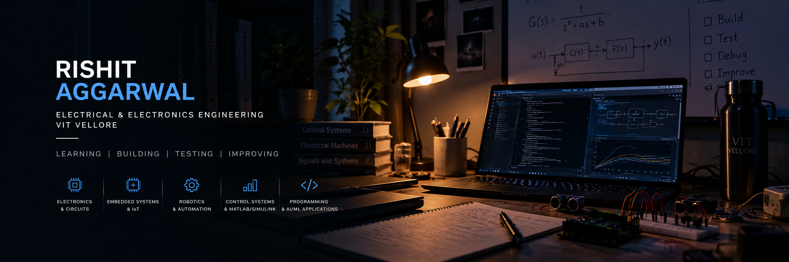

 

  

# Hi, I'm Rishit 👋

**Electrical & Electronics Engineering Student · VIT Vellore**

Interested in electronics, embedded systems, automation, and control engineering. I enjoy understanding how things work and documenting what I learn through practical projects.

---

## Areas of Interest

- **Electronics:** Circuit design, sensors, and electronic systems
- **Embedded Systems:** Arduino, ESP32, and IoT
- **Automation:** Robotics and sensor-based systems
- **Control Engineering:** System modeling and MATLAB/Simulink
- **Software:** Programming and AI/ML applications

## Selected Projects

### Tilt-Based LED Waterflow System
A tilt-controlled LED sequence using a 555 timer, CD4017, and tilt sensors.

### Smart Dustbin
An electronics project exploring sensor-based automation.

### ESP32-CAM Experiments
Exploring embedded camera hardware and configuration.

### Control Systems
Modeling and simulation work using MATLAB/Simulink.

*Project details, implementation status, and supporting files will be documented in their respective repositories.*

## Tools & Technologies

- **Hardware:** Arduino, ESP32, sensors, electronic components
- **Engineering:** MATLAB, Simulink
- **Version Control:** Git, GitHub
- **Programming:** C/C++, Python — include only what you've used

## Currently Learning

- Embedded systems and IoT
- Control engineering
- Python fundamentals
- Technical documentation and version control

## Connect

- [GitHub](https://github.com/aggarwalrishit9)
- [LinkedIn](https://www.linkedin.com/in/rishit-aggarwal-88504b419/)

---

  <i>Learning by building, testing, and improving.</i>

